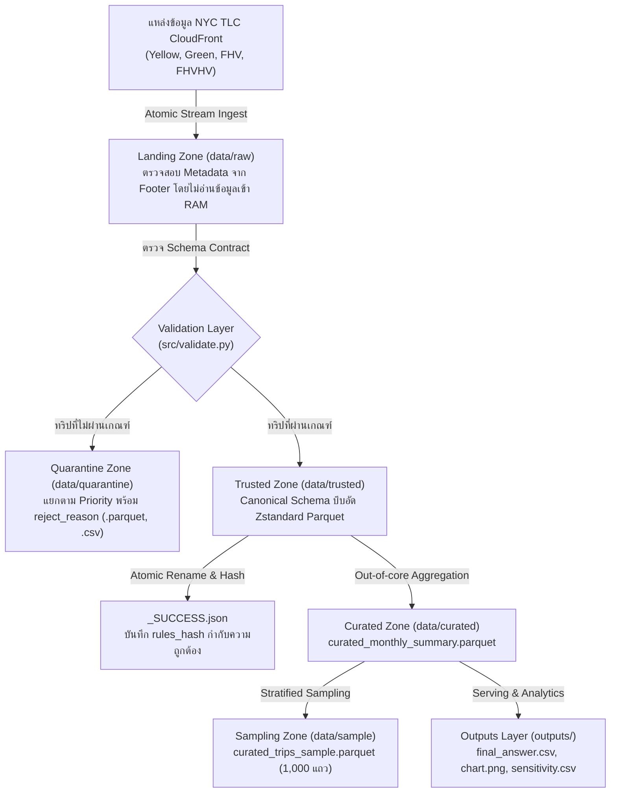

# NYC Taxi Big Data Pipeline (CS341 Submission 2)

> **วิชา:** CS341 Big Data Engineering มหาวิทยาลัยธรรมศาสตร์  
> **รหัสนักศึกษา:** 6709650565  
> **งาน Submission 1 เดิม (Baseline):** [`notebooks/6709650565_Submission_1_cs341.ipynb`](notebooks/6709650565_Submission_1_cs341.ipynb)  
> **เวอร์ชันของ Pipeline:** `2.0.0`

---

## 1. บทสรุปและคำตอบ (Executive Summary & Core Answer)

**คำถามหลักของโจทย์:** *"Which taxi type was the most used in the first half of 2024 (2024-01 ถึง 2024-06)?"*

**คำตอบ:** **High Volume For-Hire Vehicle (FHVHV เช่น Uber และ Lyft)** เป็นประเภทแท็กซี่ที่มีปริมาณการใช้งานสูงที่สุดในมหานครนิวยอร์กตลอดครึ่งแรกของปี 2024 โดยมีจำนวนเที่ยววิ่งที่ผ่านการคลีนแล้วทั้งสิ้น **120,864,668 ทริป** คิดเป็นส่วนแบ่งการตลาดสูงถึง **80.76%**

| อันดับ | ประเภทแท็กซี่ | จำนวนทริป Valid (H1 2024) | ส่วนแบ่งการตลาด (%) | ส่วนต่างเทียบกับอันดับ 2 |
|:---:|:---|:---:|:---:|:---:|
| **1** | **FHVHV (High Volume FHV)** | **120,864,668** | **80.76%** | **+100,532,914 ทริป (5.94 เท่าของ Yellow)** |
| 2 | Yellow Taxi | 20,331,754 | 13.59% | รองชนะเลิศ |
| 3 | FHV (Traditional FHV) | 8,119,228 | 5.43% | — |
| 4 | Green Taxi | 339,801 | 0.23% | — |
| **รวม** | **ทุกประเภทแท็กซี่** | **149,655,451** | **100.00%** | **Reconciliation Diff: 0 แถว (ตรงกับ S1 ครบทุกแถว)** |


---

## 2. การเริ่มต้นใช้งานอย่างรวดเร็ว (Quick Start)

Pipeline นี้พัฒนาบนสภาพแวดล้อม **Python 3.10+** โดยมีการระบุและล็อกเวอร์ชันของ Library อย่างเคร่งครัดในไฟล์ [`requirements.txt`](requirements.txt)

### 2.1 การติดตั้งสภาพแวดล้อม
```bash
# Clone repository
git clone <repo-url>
cd NYCTAXI2_BIGDATA

# ติดตั้ง dependencies ที่ระบุเวอร์ชันตรงกัน
python -m pip install -r requirements.txt
```

### 2.2 การทดสอบระบบเบื้องต้น (Smoke Test ภายใน ~2 วินาที)
สามารถทดสอบการทำงานของ Pipeline แบบ End-to-End ได้ทันทีโดยไม่ต้องเสียเวลาดาวน์โหลดไฟล์ขนาดหลายกิกะไบต์ ด้วยการรันไฟล์ขนาดเล็ก `green 2024-01` (~1.3 MB):
```bash
# บังคับประมวลผล Green 2024-01
python run_pipeline.py --types green --months 2024-01 --mode force
```

### 2.3 การสาธิตคุณสมบัติ Idempotency (ข้ามการรันซ้ำทันที)
เมื่อสั่งรันคำสั่งเดิมด้วยโหมด `--mode skip` ระบบจะตรวจสอบ `_SUCCESS.json` และค่า Hash ของกฎ หากตรงกันจะข้ามการคำนวณทั้งหมดภายในเวลาไม่ถึง **0.05 วินาที**:
```bash
# ข้าม batch ที่เคยประมวลผลแล้วและกฎไม่เปลี่ยนแปลง
python run_pipeline.py --types green --months 2024-01 --mode skip
```

### 2.4 การประมวลผลชุดข้อมูล H1 2024 ทั้งหมด (ครบ 24 Batches)
```bash
python run_pipeline.py --months 2024-01 2024-02 2024-03 2024-04 2024-05 2024-06 --mode skip
```

### 2.5 การสาธิตการอัปเดตข้อมูลส่วนเพิ่ม (Incremental Update: Yellow 2024-07)
สาธิตการนำเข้าข้อมูลเดือนใหม่ โดยระบบจะไม่ประมวลผลข้อมูลในอดีตซ้ำ และไม่กระทบต่อผลการทดสอบ Regression ของ H1:
```bash
python run_pipeline.py --types yellow --months 2024-01 2024-02 2024-03 2024-04 2024-05 2024-06 2024-07 --mode skip
```

---

## 3. โครงสร้างของ Repository (Project Structure)

```text
NYCTAXI2_BIGDATA/
├── README.md                           # เอกสารสถาปัตยกรรม ผลการวิเคราะห์ และหลักฐานการรัน
├── .gitignore                          # ยกเว้นไฟล์ข้อมูล Raw, Trusted และไฟล์ชั่วคราว
├── requirements.txt                    # กำหนดเวอร์ชัน dependencies: duckdb, pyarrow, pandas, matplotlib
├── config.py                           # ศูนย์กลางการตั้งค่า Schema Map, Paths, Rules และ Rules Hash
├── run_pipeline.py                     # CLI Orchestrator หลักสำหรับควบคุมการทำงาน
├── notebooks/
│   └── 6709650565_Submission_1_cs341.ipynb  # โน้ตบุ๊กงาน Submission 1 เดิม (เก็บไว้เป็น Baseline)
├── src/
│   ├── __init__.py
│   ├── ingest.py                       # ดาวน์โหลดแบบ Atomic Stream และอ่าน Metadata จาก Footer
│   ├── validate.py                     # ตรวจสอบ Schema Contracts และคำนวณ Data Quality Audit
│   ├── transform.py                    # สตรีม Transform ผ่าน DuckDB และทำ Atomic File Swap
│   ├── curate.py                       # สรุปผลระดับ Curation (Monthly Summary) และสุ่มตัวอย่าง Stratified Sample
│   └── analyze.py                      # ตอบคำถามธุรกิจ ตรวจสอบ Regression และทำ Sensitivity Analysis (ส่วนเสริม A)
├── scripts/
│   └── deploy_athena.py                # (ส่วนเสริม B) สคริปต์ Deploy Curated Parquet ขึ้น S3 และเตรียม Athena
├── sql/
│   └── athena_setup.sql                # (ส่วนเสริม B) สคริปต์ DDL สำหรับ AWS Athena & Glue Data Catalog
├── data/
│   ├── raw/                            # ข้อมูล Parquet ดิบจาก CloudFront (gitignored)
│   ├── trusted/                        # ข้อมูล Parquet ที่ Clean และจัด Partition แล้ว (gitignored)
│   ├── quarantine/                     # ข้อมูลที่ไม่ผ่านเกณฑ์ พร้อมระบุ reject_reason (.parquet, .csv)
│   │   ├── taxi_type=green/...
│   │   └── taxi_type=yellow/...
│   ├── curated/                        # ข้อมูลสรุปรายเดือนสำหรับเสิร์ฟต่อ (tracked ใน git)
│   │   ├── curated_monthly_summary.csv
│   │   └── curated_monthly_summary.parquet
│   └── sample/                         # ตัวอย่างข้อมูล 1,000 แถวแบบแบ่งชั้น (tracked ใน git)
│       ├── curated_trips_sample.csv
│       └── curated_trips_sample.parquet
├── logs/
│   ├── pipeline_run_log.csv            # ประวัติการทำงานทุกครั้งและสถานะ Execution
│   ├── dq_report_by_batch.csv          # รายงานการละเมิดกฎ Data Quality แยกตามราย batch
│   └── run_manifest_latest.json        # สถานะภาพรวมและผลการตรวจสอบ Regression ล่าสุด
└── outputs/
    ├── final_answer_by_taxi_type.csv   # ตารางจัดอันดับการใช้งานแท็กซี่ H1 2024
    ├── sensitivity_analysis.csv        # ผลการทดสอบความอ่อนไหวของกฎการคลีนข้อมูล
    └── taxi_usage_h1_2024.png          # แผนภูมิแท่งและกราฟแนวโน้มความละเอียดสูง (300 DPI)
```

---

## 4. สถาปัตยกรรมของ Pipeline และผังการไหลของข้อมูล (Architecture & Data Lineage)

ระบบได้รับการออกแบบเป็น Modular Pipeline ตามหลักการ Data Engineering ชั้นนำ (*Schema Contracts*, *Out-of-Core Streaming*, *Atomic Staging*, และ *Serving Views*):



### รายละเอียดในแต่ละขั้น
1. **Landing Zone (`data/raw/`):** สตรีมดาวน์โหลดลงไฟล์ชั่วคราว `.tmp` ก่อนเปลี่ยนชื่อแบบ Atomic (`os.replace`) และอ่านจำนวนแถวจาก Parquet Footer Metadata ผ่าน `pyarrow.parquet.ParquetFile` โดยไม่โหลดข้อมูลเข้า RAM
2. **Validation Layer (`src/validate.py`):** ตรวจสอบ Schema Contract เทียบกับ `config.SCHEMA_MAP` เพื่อรองรับชื่อคอลัมน์ที่แตกต่างกันของแต่ละแท็กซี่ (`tpep_*`, `lpep_*`, `dropOff_datetime`, `PUlocationID`)
3. **Trusted Zone (`data/trusted/`):** แปลงข้อมูลผ่าน DuckDB Streaming `COPY` บีบอัดด้วย Zstandard และตัดคอลัมน์ดิบที่ไม่จำเป็นออก เหลือเพียง 7 Canonical Analytical Columns ตามที่กำหนดใน `config.TRUSTED_COLUMNS` ได้แก่ `pickup_ts`, `dropoff_ts`, `pu_location_id`, `do_location_id`, `trip_duration_seconds`, `taxi_type`, และ `batch_month`
   - **ชุดข้อมูล H1 2024 (24 ไฟล์):** ขนาดไฟล์ดิบ (Raw) `3,191.23 MB` ลดลงเหลือในชั้น Trusted เพียง **`1,357.44 MB`** (ประหยัดพื้นที่ลงถึง **57.46%**)
   - **ชุดข้อมูลรวมเดือนกรกฎาคม 2024-07 (25 ไฟล์):** ขนาดไฟล์ดิบ `3,241.10 MB` ลดลงเหลือในชั้น Trusted เพียง **`1,388.11 MB`** (ประหยัดพื้นที่ลง **57.17%**)
4. **Quarantine Zone (`data/quarantine/`):** บันทึกแถวที่ไม่ผ่านเกณฑ์การคลีนลงในโฟลเดอร์แยกต่างหาก พร้อมระบุคอลัมน์ `reject_reason` ในรูปแบบทั้ง Parquet และ CSV เพื่อให้ตรวจสอบสาเหตุย้อนหลังได้ทุกแถว
5. **Curation & Serving Layer (`data/curated/`, `outputs/`):** สรุปผลระดับ Aggregate รายเดือน และประมวลผลผ่านตารางสรุปใน DuckDB (`monthly_summary`) สำหรับนำไปคำนวณอันดับและสร้างชาร์ต

---

## 5. หลักฐานการประมวลผลและความเป็น Idempotent (Execution & Idempotency Evidence)

บันทึกประวัติการรันจริงทั้งหมดถูกเก็บไว้ใน [`logs/pipeline_run_log.csv`](logs/pipeline_run_log.csv) และ [`logs/run_manifest_latest.json`](logs/run_manifest_latest.json)

### Run 1: การประมวลผลเต็มรูปแบบ H1 2024 (24 Batches)
- **Run ID:** `ae02785e` | **โหมด:** `FORCE`
- **เวลาทำงานรวม (Wall Time):** `1,125.15 วินาที` (~18.7 นาที) *(ประกอบด้วยเวลาประมวลผล 24 batches รวม 839.47 วินาทีตามที่บันทึกใน `logs/pipeline_run_log.csv` และขั้นตอน Curation ร่วมกับ Sensitivity Analysis หลังรันเสร็จอีก ~285.68 วินาที)*
- **จำนวนแถว Raw ที่รับเข้า:** `149,655,796` แถว
- **จำนวนแถว Cleaned Valid:** `149,655,451` แถว
- **จำนวนแถว Quarantine:** `345` แถว
- **ผลการทดสอบ H1 Regression Check:** `PASSED` (Diff = 0 แถว)

### Run 2: การสาธิตการรันซ้ำแบบ Idempotent (ข้ามทั้ง 24 Batches)
- **Run ID:** `6fe1ebe9` | **โหมด:** `SKIP`
- **เวลาในการตรวจสอบต่อ batch:** `< 0.05 วินาที` (บันทึก `0.0s` ใน `logs/pipeline_run_log.csv`, ข้ามครบทั้ง 24 batches โดยบันทึกสถานะ `SKIPPED_ALREADY_PROCESSED`)
- **จำนวนแถวที่ต้องประมวลผลซ้ำ:** `0` แถว
- **การรับประกันความถูกต้อง:** ตรวจสอบทั้งการมีอยู่ของ `_SUCCESS.json` และความตรงกันของ `rules_hash`

### Run 3: การประมวลผลข้อมูลส่วนเพิ่ม (Incremental Update: Yellow 2024-07)
*(หมายเหตุ: การรัน Yellow 2024-07 เป็นการสาธิตความสามารถในการอัปเดตข้อมูลส่วนเพิ่มเฉพาะประเภท Yellow Taxi เท่านั้น ไม่ใช่การจัดอันดับเปรียบเทียบข้ามประเภทของเดือนกรกฎาคม)*
- **Run ID:** `7c3f23e2` | **โหมด:** `SKIP`
- **Batches ที่ข้ามอัตโนมัติ:** `6` batches (`yellow 2024-01` ถึง `yellow 2024-06`)
- **Batch ที่ประมวลผลใหม่:** `1` batch (`yellow 2024-07`)
  - แถว Raw: `3,076,903` | แถว Valid: `3,076,851` | แถว Quarantine: `52`
  - เวลาในการประมวลผล batch นี้: `18.06 วินาที`
- **ความเสถียรของผลลัพธ์ H1:** `PASSED` (ยอดรวม Valid H1 ยังคงเท่ากับ `149,655,451` ทริปอย่างถูกต้อง) ข้อมูลเดือนใหม่ถูกผนวกเข้าสู่ `curated_monthly_summary.csv` เป็น 25 แถว โดยไม่รบกวนข้อมูลสรุปของ H1 เดิม

---

## 6. การตัดสินใจเชิงออกแบบที่สำคัญ (Key Design Decisions)

### การตัดสินใจที่ 1: แยกเดือนของไฟล์ (`batch_month`) ออกจากเวลาทริปจริง (`pickup_ts`)
- **ปัญหาที่พบ:** ไฟล์ Parquet รายเดือนของ NYC TLC มักมีข้อมูลทริปที่ข้ามรอยต่อเดือนหลงเข้ามา (เช่น ทริปปลายเดือนธันวาคมในไฟล์เดือนมกราคม หรือทริปเดือนมิถุนายนในไฟล์เดือนกรกฎาคม) ใน Submission 1 นักศึกษานับข้อมูลยึดตามไฟล์ batch เป็นหลัก
- **การออกแบบ:** กำหนด `batch_month` (string เช่น `'2024-01'`) ตามไฟล์ที่นำเข้าสำหรับใช้ในการแบ่ง Partition และการทดสอบ Regression ขณะเดียวกันก็เก็บ `pickup_ts` ไว้วิเคราะห์เวลาทริปอย่างละเอียด
- **ผลลัพธ์:** ป้องกันไม่ให้ทริปหลงเดือนข้ามย้าย batch ซึ่งจะทำให้ตัวเลขไม่ตรงกับ Baseline และทำให้สามารถกระทบยอดกับ Submission 1 ได้แม่นยำ 100%

### การตัดสินใจที่ 2: การเขียนไฟล์แบบ Atomic และการทำ Rules Fingerprint (`rules_hash`)
- **ปัญหาที่พบ:** หากกระบวนการทำงานสะดุดระหว่างเขียนไฟล์ อาจเกิดไฟล์ Parquet เสียหายค้างอยู่ในระบบ นอกจากนี้ โหมด Skip แบบทั่วไปอาจเสิร์ฟผลลัพธ์เก่าหากผู้ใช้มีการแก้ไขกฎการคลีนข้อมูล
- **การออกแบบ:** เขียนไฟล์ชั่วคราวลงใน `.tmp` เสมอ เมื่อตรวจสอบยอดแถวสมบูรณ์แล้วจึงสลับชื่อไฟล์ด้วย `os.replace()` พร้อมทั้งสร้างไฟล์ `_SUCCESS.json` ที่บันทึกค่า SHA-256 (`rules_hash`) ซึ่งคำนวณจากเวอร์ชันของ Pipeline, Schema Mapping, รายชื่อคอลัมน์ และขอบเขตวันที่
- **ผลลัพธ์:** ขจัดปัญหาไฟล์เขียนไม่เสร็จค้างในระบบ และหากมีการแก้ไขกฎในโค้ด ระบบจะตรวจพบว่า Hash ไม่ตรงกันและทำการประมวลผลใหม่ให้อัตโนมัติ

### การตัดสินใจที่ 3: การจัดลำดับความสำคัญใน Quarantine และการนับ Overlapping DQ
- **ปัญหาที่พบ:** ข้อมูลที่ไม่สมบูรณ์หนึ่งแถวอาจละเมิดกฎหลายข้อพร้อมกัน (เช่น ทั้งเวลา pickup เป็นค่าว่าง และเวลา dropoff น้อยกว่าเวลา pickup) หากนับแยกรายกฎแล้วนำมาบวกกัน ยอดรวมจะไม่เท่ากับจำนวนแถว invalid จริง ทำให้สมการ $\text{Raw} = \text{Valid} + \text{Invalid}$ ไม่ลงตัว
- **การออกแบบ:** กำหนดลำดับความสำคัญของกฎแบบ Mutually Exclusive สำหรับระบุ `reject_reason` เพียงค่าเดียวใน Quarantine:
  $$\text{null\_pickup} \longrightarrow \text{null\_dropoff} \longrightarrow \text{dropoff\_before\_pickup} \longrightarrow \text{pickup\_out\_of\_period}$$
  ขณะเดียวกัน ระบบก็นับจำนวนการละเมิดกฎแต่ละข้อแบบซ้อนทับ (Overlapping) แยกไว้ใน `logs/dq_report_by_batch.csv` เพื่อใช้วิเคราะห์คุณภาพข้อมูล
- **ผลลัพธ์:** ทำให้สามารถกระทบยอดบัญชีข้อมูลได้อย่างสมบูรณ์ และยังคงเห็นข้อมูลเชิงลึกของการละเมิดกฎทุกข้อครบถ้วน

### การตัดสินใจที่ 4: สถาปัตยกรรม Out-of-Core และพฤติกรรมการใช้หน่วยความจำ
- **บริบทเดิม:** ใน Submission 1 มีการใช้ DuckDB คิวรีข้อมูลดิบแบบ Interactive ภายใน Session ของ Jupyter Notebook โดยไม่ได้บันทึกชั้นข้อมูล Trusted ที่แบ่ง Partition ลงดิสก์อย่างถาวร สำหรับ Submission 2 โจทย์ต้องการให้สร้าง Data Pipeline เต็มรูปแบบที่เขียนข้อมูล Trusted 150 ล้านแถวลงดิสก์อย่างมีประสิทธิภาพ
- **การออกแบบ:** ใช้ DuckDB Streaming Engine อ่านและแปลงข้อมูลเป็นชุดย่อย (Chunks) ส่งตรงไปยังไฟล์ Parquet บีบอัดบนดิสก์โดยตรง
- **พฤติกรรมการใช้หน่วยความจำจริง:**
  - ค่าจำกัดหน่วยความจำโดยปริยาย (DuckDB Default Limit): ตั้งไว้ที่ 12.5 GiB (คิดเป็น 80% ของ RAM 16 GB ของเครื่อง)
  - ระหว่างการคิวรีอ่านข้อมูลเพื่อคำนวณสถิติและทำ Curation: วัดค่า Working Set ของ Process ได้ไม่เกิน **205 MB**
  - ระหว่างการเขียนไฟล์แปลงข้อมูล Parquet ก้อนที่ใหญ่ที่สุด (`fhvhv 2024-03`, จำนวน 21.28 ล้านแถว): วัดค่า Peak Working Set ได้ **3,070.38 MB** (~3.07 GB วัดผ่าน Win32 API `GetProcessMemoryInfo`) ซึ่งทำงานอยู่ภายในขอบเขตของ Physical RAM ได้อย่างปลอดภัยโดยไม่มีการสลับข้อมูลลง Pagefile และไม่มีปัญหา Memory Leak

---

## 7. การตรวจสอบคุณภาพข้อมูลและการกระทบยอดกับ Submission 1 (Data Quality & Reconciliation)

### 7.1 การกระทบยอดเชิงตัวเลขกับ Submission 1 Baseline
ผลการรันจริงของ Pipeline ได้ตัวเลขตรงกับงาน Submission 1 เดิมทุกประเภทแท็กซี่ โดยมีผลต่างเท่ากับ 0:

| ประเภทแท็กซี่ | แถว Raw นำเข้า | Submission 1 Valid | Pipeline Valid | แถว Quarantine | ผลต่าง (Diff) | สถานะ |
|:---|:---:|:---:|:---:|:---:|:---:|:---:|
| **Yellow** | 20,332,093 | 20,331,754 | **20,331,754** | 339 | 0 | **ตรงกันสมบูรณ์** |
| **Green** | 339,807 | 339,801 | **339,801** | 6 | 0 | **ตรงกันสมบูรณ์** |
| **FHV** | 8,119,228 | 8,119,228 | **8,119,228** | 0 | 0 | **ตรงกันสมบูรณ์** |
| **FHVHV** | 120,864,668 | 120,864,668 | **120,864,668** | 0 | 0 | **ตรงกันสมบูรณ์** |
| **รวมทั้งสิ้น** | **149,655,796** | **149,655,451** | **149,655,451** | **345** | **0** | **Reconciliation 100%** |

### 7.2 จำแนกรายละเอียดของข้อมูลที่ถูกส่งเข้า Quarantine (H1 2024)
จากข้อมูลทั้งสิ้น 149.65 ล้านแถวในครึ่งปีแรก มีข้อมูลไม่ผ่านเกณฑ์ถูกคัดแยกเข้า Quarantine รวม **345 แถว** (Yellow: 339 แถว, Green: 6 แถว, FHV: 0 แถว, FHVHV: 0 แถว) โดยมีสาเหตุดังนี้:
- **`dropoff_before_pickup` (300 แถว):** ทั้งหมด 300 แถวมาจาก Yellow Taxi (เช่น เดือนมีนาคมมี 117 แถวที่เวลาส่งผู้โดยสารเกิดขึ้นก่อนเวลารับ)
- **`pickup_out_of_period` (45 แถว):** มาจาก Yellow 39 แถว และ Green 6 แถว เมื่อเจาะดูข้อมูลเวลาทริปจริงพบการกระจายตัวของปีดังนี้:
  - **ความผิดปกติของนาฬิกา/อุปกรณ์ในอดีต:** ปี 2002 (Yellow 10 แถว), ปี 2008 (Yellow 5 แถว, Green 2 แถว), ปี 2009 (Yellow 9 แถว, Green 2 แถว), ปี 2023 (Yellow 10 แถว, Green 2 แถว)
  - **ความผิดปกติข้ามช่วงรอยต่อและเวลาในอนาคต:** ปี 2024 (Yellow 3 แถวที่เวลาหลุดขอบเขตช่วง), ปี 2026 (Yellow 2 แถวที่มีเวลาหลุดไปในอนาคต เช่น `2026-06-26 23:53:12`)
- **`null_pickup` / `null_dropoff` (0 แถว):** ไม่พบค่าว่างในคอลัมน์ Timestamp ของข้อมูลปี 2024 H1

### 7.3 ข้อค้นพบด้านคุณภาพข้อมูล: อัตราค่าว่างของ Location ID ใน FHV
จากการตรวจสอบคอลัมน์สถานที่พบว่า **~78% ของข้อมูล FHV** มีค่าว่าง (`NULL`) ในคอลัมน์ `PUlocationID` (คิดเป็น 963,825 ถึง 1,191,229 แถวต่อเดือน)  
- ตามหลักการ *Missing ≠ Invalid* จากเอกสารการสอน จึงกำหนดให้คอลัมน์ `pu_location_id` และ `do_location_id` เป็น Nullable แทนที่จะคัดข้อมูลทิ้ง ทำให้สามารถรักษาข้อมูลทริปที่ถูกต้องของ FHV ไว้ได้กว่า 8.11 ล้านแถว

---

## 8. Sensitivity Analysis และ Serving View บน Cloud 

### 8.1 Sensitivity Analysis 

เพื่อทดสอบความหนักแน่นของข้อสรุปธุรกิจ ได้ทำการทดสอบ Sensitivity Analysis กับกฎการกรองข้อมูลทางเลือกเพิ่มเติม ([`outputs/sensitivity_analysis.csv`](outputs/sensitivity_analysis.csv)):

| สถานการณ์จำลอง | จำนวนทริป FHVHV | จำนวนทริป Yellow | ผู้ชนะ | ส่วนต่างนำอันดับ 2 | ผู้ชนะเปลี่ยนหรือไม่? |
|:---|:---:|:---:|:---:|:---:|:---:|
| **1. กฎมาตรฐาน (Baseline)** | **120,864,668** | 20,331,754 | **FHVHV** | **+100,532,914** | **ไม่เปลี่ยน** |
| 2. ตัดทริปที่มีระยะเวลา 0 วินาทีออก | 120,864,656 | 20,325,877 | **FHVHV** | +100,538,779 | **ไม่เปลี่ยน** |
| 3. ตัดทริปที่มีระยะเวลาเกิน 24 ชั่วโมงออก | 120,864,668 | 20,331,645 | **FHVHV** | +100,533,023 | **ไม่เปลี่ยน** |
| 4. ตัดทริปที่ซ้ำกัน (พิจารณาเฉพาะแถวที่ Location ไม่ว่าง) | 120,864,373 | 20,105,621 | **FHVHV** | +100,758,752 | **ไม่เปลี่ยน** |

*(หมายเหตุ: ในสถานการณ์จำลองที่ 4 เป็นการทดสอบตัดทริปซ้ำบนแถวที่มี Location ครบถ้วน (`pu_location_id IS NOT NULL AND do_location_id IS NOT NULL`) เพื่อป้องกันผลกระทบจากข้อจำกัดของข้อมูล FHV ดั้งเดิมที่มีค่าว่าง Location ถึง 78.33% ซึ่งทำให้ในกรณี FHV มีทริปซ้ำลดลงไปเพียง 1,558 แถว)*

**สรุปผล:** ข้อสรุปที่ว่า **FHVHV เป็นแท็กซี่ที่มีการใช้งานมากที่สุด** มีความหนักแน่นและไม่แปรเปลี่ยนตามทางเลือกการคลีนข้อมูลใดๆ โดยมีทริปนำอันดับสองอยู่มากกว่า **100.5 ล้านทริป** (5.94 เท่าของ Yellow Taxi) ในทุกสถานการณ์จำลอง

### 8.2 Serving Views บน Cloud ผ่าน Amazon Athena & AWS S3 

ต่อยอดจากแนวคิด *Views as a Serving Layer* และ *Reproducibility Ladder* (Module 02) โดยจัดเตรียม DDL Script และเครื่องมือ Deploy ข้อมูลสรุป Curated ขึ้นสู่ระบบคลาวด์:
- **สคริปต์ DDL สำหรับ Amazon Athena:** [`sql/athena_setup.sql`](sql/athena_setup.sql) ประกอบด้วย:
  1. `CREATE EXTERNAL TABLE nyc_taxi_curated.curated_monthly_summary`: อ่านไฟล์ Parquet บีบอัด Zstandard จาก S3 โดยตรงแบบ Serverless
  2. `CREATE VIEW nyc_taxi_curated.v_curated_monthly_summary`: สำหรับคิวรีสถิติรายเดือนครบทุก batch
  3. `CREATE VIEW nyc_taxi_curated.v_h1_2024_ranking`: Serving View ตอบคำถามหลัก กรองเฉพาะ H1 2024 และคำนวณ Market Share อัตโนมัติ
- **สคริปต์ตัวช่วย Deploy ([`scripts/deploy_athena.py`](scripts/deploy_athena.py)):**
  - รองรับการ Sync ไฟล์ `curated_monthly_summary.parquet` ขึ้น S3 Bucket ด้วยคำสั่ง:
    ```bash
    python scripts/deploy_athena.py --bucket <your-s3-bucket-name>
    ```
  - รองรับโหมด `--dry-run` เพื่อสร้างคำสั่ง SQL ที่ผูกกับชื่อ Bucket อัตโนมัติโดยไม่ต้องใช้ AWS Credentials:
    ```bash
    python scripts/deploy_athena.py --bucket <your-s3-bucket-name> --dry-run
    ```

---

## 9. ตารางเปรียบเทียบ Submission 1 กับ Submission 2

| มิติการประเมิน | Submission 1 (Baseline Notebook) | Submission 2 (Production Pipeline) |
|:---|:---|:---|
| **รูปแบบการประมวลผล (Architecture)** | โน้ตบุ๊กเดี่ยว (Monolithic Jupyter Notebook) | แยกโมดูลตามหน้าที่ชัดเจน (`src/`, `config.py`, CLI) |
| **การจัดเก็บข้อมูลและ Data Lineage** | คิวรีชั่วคราวในหน่วยความจำ ไม่มีชั้น Trusted บนดิสก์ | จัดเก็บชั้น Trusted แบ่ง Partition ชัดเจน บีบอัด Zstandard |
| **ความสามารถในการทำซ้ำ (Reproducibility)** | รันแบบ Interactive ผ่าน Cell ในโน้ตบุ๊ก | รันคำสั่งเดียวผ่าน CLI พร้อมไฟล์ `requirements.txt` ที่ล็อกเวอร์ชัน |
| **การรันซ้ำอย่างปลอดภัย (Idempotency)** | สั่งรันใหม่จะต้องคิวรีและประมวลผลใหม่ทั้งหมด | ตรวจสอบ `_SUCCESS.json` และ `rules_hash` ข้ามการทำงานซ้ำใน 0.05 วิ |
| **การอัปเดตข้อมูลส่วนเพิ่ม (Incremental)** | ไม่รองรับ ต้องเริ่มรันใหม่ทั้งหมด | เพิ่มเฉพาะ batch ใหม่ (เช่น Yellow 2024-07 ใน 18 วิ) โดยไม่รันข้อมูลเก่าซ้ำ |
| **การจัดการคุณภาพข้อมูล (Data Quality)** | กรองข้อมูลทิ้งแบบเงียบๆ ไม่ทราบสาเหตุ | คัดแยกเข้า Quarantine Zone พร้อมระบุ `reject_reason` ทุกแถว |
| **การทดสอบความถูกต้อง (Testing)** | ตรวจสอบด้วยสายตาจากตารางในโน้ตบุ๊ก | มีระบบ Automated H1 Regression Check ตรวจสอบยอดเทียบ Baseline อัตโนมัติ |

---

## 10. ข้อจำกัดของระบบ (Pipeline Limitations)

1. **การทำงานบนเครื่องเดี่ยว (Single-Node Execution):** ระบบได้รับการออกแบบให้ทำงานบนเครื่องคอมพิวเตอร์เครื่องเดียวได้อย่างมีประสิทธิภาพสูงผ่าน DuckDB และ PyArrow (~18 นาทีสำหรับ 150 ล้านแถว) หากต้องการขยายสเกลเพื่อรองรับข้อมูลที่ใหญ่ขึ้นในระดับคลัสเตอร์หลายเครื่อง จะต้องเปลี่ยนไปใช้ Distributed Engine เช่น Apache Spark หรือ Trino
2. **การประมวลผลแบบ Batch (Batch-Oriented):** ระบบทำงานกับข้อมูลทริปแบบไฟล์ Parquet รายเดือน ไม่ได้รองรับการสตรีมข้อมูลแบบ Real-time (เช่น Apache Kafka หรือ Apache Flink)
3. **การพึ่งพาแหล่งข้อมูลภายนอก (External Upstream Dependency):** ขั้นตอน Ingestion ดาวน์โหลดไฟล์โดยตรงจาก CloudFront ของ NYC TLC หากฝั่งต้นทางมีการเปลี่ยนโครงสร้าง URL หรือเปลี่ยน Schema คอลัมน์ จะต้องเข้ามาปรับค่าใน `SCHEMA_MAP`

---

## 11. บทเรียนและการสะท้อนการเรียนรู้ (Learning Reflection)

ใน Submission 1 การทำงานเป็นการวิเคราะห์ข้อมูลเชิงสำรวจใน Jupyter Notebook ซึ่งสามารถตอบคำถามธุรกิจได้แต่ยังขาดการจัดเก็บข้อมูลเป็นชั้นๆ การตรวจสอบย้อนกลับ และระบบทดสอบความถูกต้องอัตโนมัติ การพัฒนา Submission 2 ทำให้ผมเข้าใจว่าวิศวกรรมข้อมูลระดับใช้งานจริง (Production Data Engineering) จำเป็นต้องมี Schema Contracts, การเขียนไฟล์แบบ Atomic และการทำ Rules Hashing เพื่อความถูกต้องและโปร่งใส การใช้ DuckDB ประมวลผลข้อมูล 149.65 ล้านแถวช่วยลดพื้นที่จัดเก็บจาก 3,191.23 MB เหลือ 1,357.44 MB และกระทบยอดกับ Submission 1 ได้แม่นยำ 100% ที่สำคัญที่สุดคือ การแยก Quarantine Zone ออกมาทำให้เราสามารถอธิบายการตัดสินใจด้านคุณภาพข้อมูลทุกแถวได้อย่างโปร่งใสและมีหลักฐานชัดเจน
