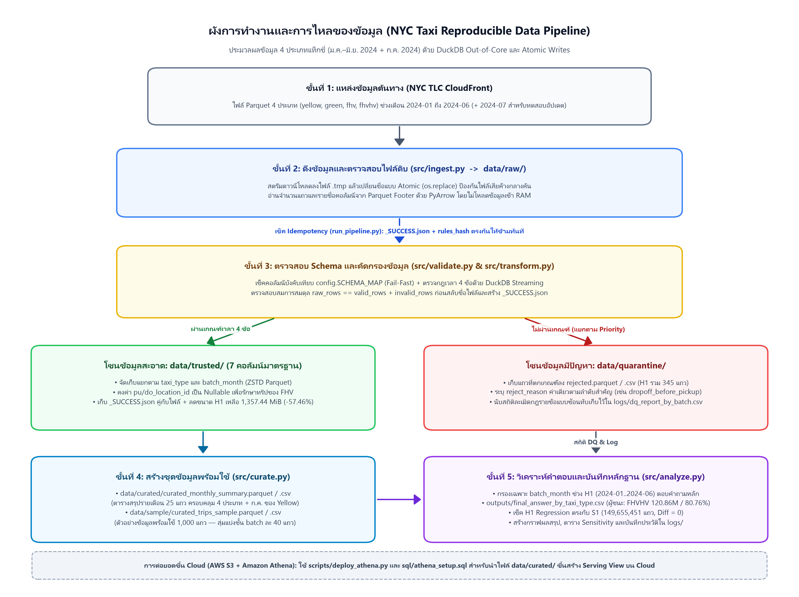
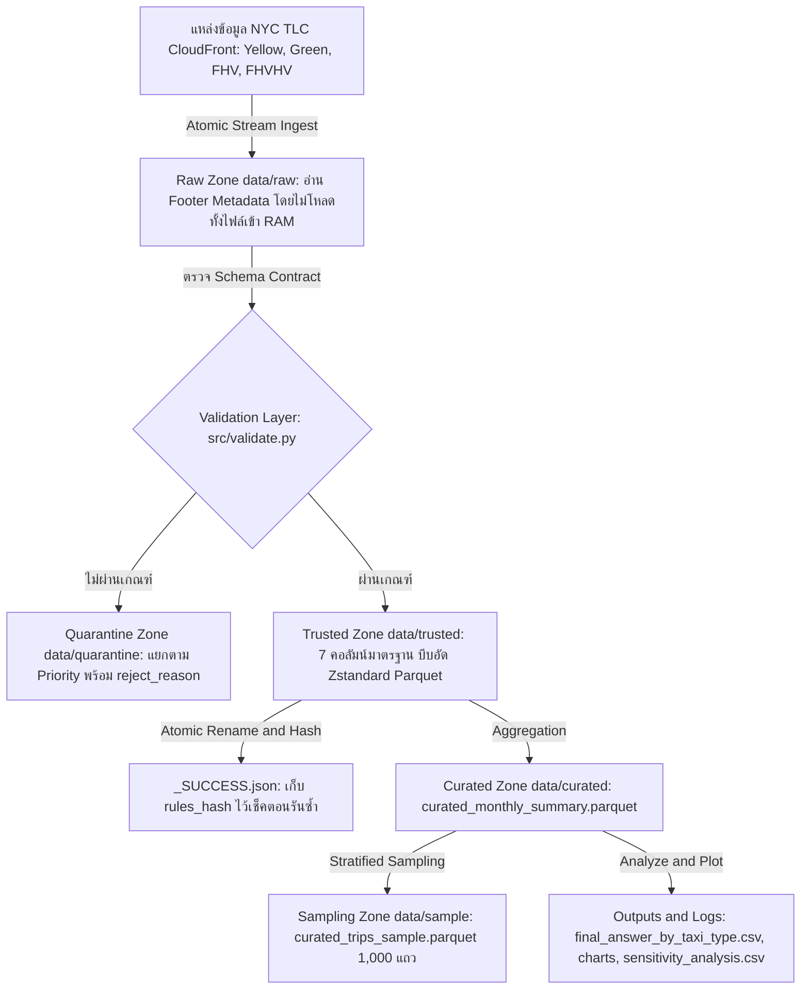
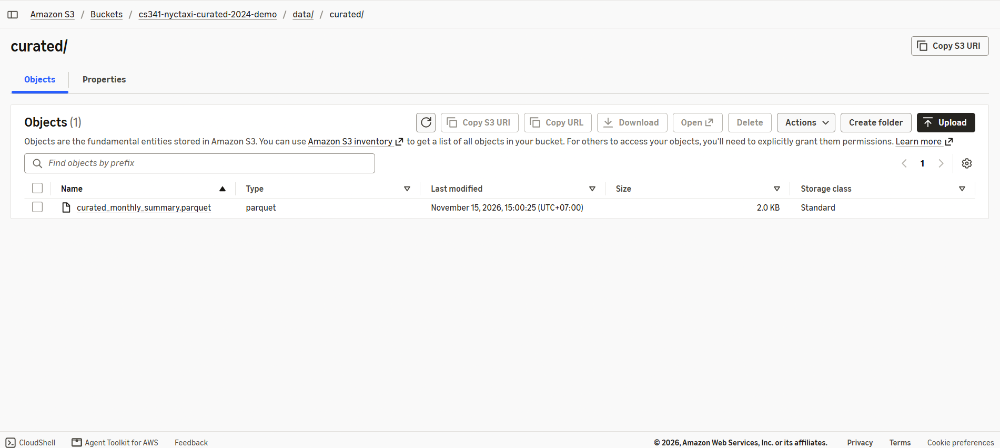
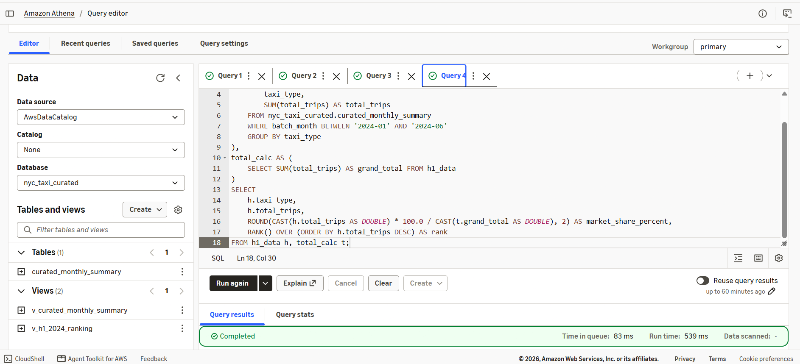
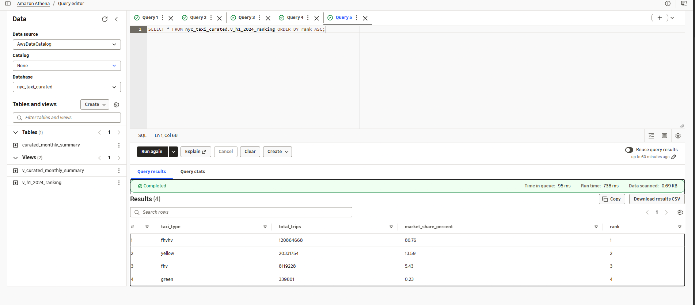

# NYC Taxi Big Data Pipeline (CS341 Submission 2)

> **วิชา:** CS341 Big Data Engineering มหาวิทยาลัยธรรมศาสตร์  
> **รหัสนักศึกษา:** 6709650565  
> **งาน Submission 1 เดิม (Baseline):** [`notebooks/6709650565_Submission_1_cs341.ipynb`](notebooks/6709650565_Submission_1_cs341.ipynb)

---

## 1. ข้อมูลที่ใช้และผลลัพธ์คำตอบหลัก

- **แหล่งข้อมูลที่ใช้:** ข้อมูลการเดินทางของรถแท็กซี่ในนิวยอร์ก 4 ประเภท ได้แก่ **Yellow**, **Green**, **FHV** และ **FHVHV** ในรูปแบบไฟล์ Parquet จากเว็บ [NYC Taxi and Limousine Commission (TLC)](https://www.nyc.gov/site/tlc/about/tlc-trip-record-data.page) ช่วงเดือน **มกราคม – มิถุนายน 2024** (และมีไฟล์ของ Yellow เดือน **กรกฎาคม 2024** เพิ่มเข้ามาใช้ทดสอบการอัปเดตข้อมูลรายเดือน)
- **ตัวชี้วัดที่ใช้เปรียบเทียบ:** นับจาก **จำนวนการเดินทางที่เกิดขึ้นจริง (Valid Trips)** โดยตัดทริปที่ข้อมูลเวลาไม่ครบ เวลาลงรถเกิดก่อนเวลาขึ้นรถ หรืออยู่นอกช่วงเวลาเป้าหมายออก เพื่อให้สะท้อนปริมาณการใช้งานจริงมากที่สุด
- **คำถามหลักของโจทย์:** *"Which taxi type was the most used in the first half of 2024?"*

**คำตอบที่ได้:** ในช่วงครึ่งปีแรกของปี 2024 **FHVHV (รถที่เรียกผ่านแอปพลิเคชัน เช่น Uber และ Lyft)** เป็นประเภทที่ถูกใช้งานมากที่สุด โดยมีจำนวนทริปที่ผ่านการคลีนแล้วทั้งหมด **120,864,668 ทริป** คิดเป็น **80.76%** ของการเดินทางทั้งหมด ทิ้งห่างอันดับ 2 อย่าง Yellow Taxi อยู่ถึง **100,532,914 ทริป (5.94 เท่า)**

| อันดับ | ประเภทแท็กซี่ | จำนวนทริป Valid (H1 2024) | ส่วนแบ่ง (%) | เทียบกับอันดับ 2 |
|:---:|:---|:---:|:---:|:---:|
| **1** | **FHVHV (High Volume FHV)** | **120,864,668** | **80.76%** | **นำอยู่ +100,532,914 ทริป (5.94 เท่าของ Yellow)** |
| 2 | Yellow Taxi | 20,331,754 | 13.59% | อันดับ 2 |
| 3 | FHV (Traditional FHV) | 8,119,228 | 5.43% | — |
| 4 | Green Taxi | 339,801 | 0.23% | — |
| **รวม** | **ทุกประเภทแท็กซี่** | **149,655,451** | **100.00%** | **ตรงกับ Submission 1 ทุกแถว (ผลต่าง = 0)** |


---

## 2. วิธีติดตั้งและวิธีรัน Pipeline

โปรเจกต์นี้พัฒนาและทดสอบรันจริงบน **Python 3.12.10** และล็อกเวอร์ชันของไลบรารีทั้งหมดไว้ใน [`requirements.txt`](requirements.txt) (`duckdb==2.0.0`, `pyarrow==26.0.1`, `pandas==3.1.1`, `matplotlib==3.11.2`)

### 2.1 การติดตั้ง
```bash
git clone https://github.com/PurinatWanthanathanya/NYCTAXI2_BIGDATA.git
cd NYCTAXI2_BIGDATA
python -m pip install -r requirements.txt
```

### 2.2 ทดสอบรันแบบเร็ว (Smoke Test ประมาณ 2 วินาที)
สามารถทดสอบการทำงานของ Pipeline ตั้งแต่ต้นจนจบด้วยไฟล์เล็กอย่าง `green 2024-01` (~1.3 MiB) ได้ทันทีโดยไม่ต้องรอโหลดข้อมูลใหญ่ทั้งหมด:
```bash
# รัน Green เดือน 2024-01 แบบบังคับประมวลผลใหม่
python run_pipeline.py --types green --months 2024-01 --mode force
```

### 2.3 ทดสอบการรันซ้ำ (Idempotency)
ถ้ารันคำสั่งเดิมอีกครั้งด้วย `--mode skip` ระบบจะเช็คไฟล์ `_SUCCESS.json` กับค่า `rules_hash` แล้วข้ามการทำงานทันทีในเวลาไม่ถึง **0.05 วินาที**:
```bash
python run_pipeline.py --types green --months 2024-01 --mode skip
```

### 2.4 รันชุดข้อมูลครึ่งปีแรกทั้งหมด (ครบ 24 ไฟล์)
*(หมายเหตุ: การรันแบบเต็มทั้ง 24 ไฟล์จำเป็นต้องเชื่อมต่ออินเทอร์เน็ตเพื่อดาวน์โหลดไฟล์จาก NYC TLC CloudFront ใช้พื้นที่ดิสก์รวมประมาณ **~4.5 GiB** (`data/raw/` 3,241 MiB + `data/trusted/` 1,388 MiB) และใช้เวลาประมวลผลประมาณ **14 นาทีสำหรับ 24 batches** หรือ 841.18 วินาที โดยยังไม่รวมขั้น curate/analyze)*
```bash
python run_pipeline.py --months 2024-01 2024-02 2024-03 2024-04 2024-05 2024-06 --mode skip
```

### 2.5 ทดสอบเพิ่มข้อมูลเดือนใหม่ (Yellow 2024-07)
ระบบจะข้าม 6 เดือนแรกที่เคยทำเสร็จแล้วอัตโนมัติ และดึงเฉพาะไฟล์เดือนกรกฎาคมมาทำต่อให้โดยไม่กระทบผลคำตอบของครึ่งปีแรก:
```bash
python run_pipeline.py --types yellow --months 2024-01 2024-02 2024-03 2024-04 2024-05 2024-06 2024-07 --mode skip
```

---

## 3. โครงสร้างไฟล์ในโปรเจกต์

```text
NYCTAXI2_BIGDATA/
├── README.md                           # เอกสารอธิบายโครงสร้าง วิธีรัน และผลวิเคราะห์ทั้งหมด
├── .gitignore                          # กันไม่ให้ไฟล์ดิบและไฟล์ชั่วคราวขนาดใหญ่ถูก commit ขึ้น Git
├── requirements.txt                    # รายการไลบรารีที่ล็อกเวอร์ชันไว้
├── config.py                           # ศูนย์กลางการตั้งค่า Path, Schema Map, กฎเวลา และ rules_hash
├── run_pipeline.py                     # สคริปต์หลักสำหรับสั่งรัน Pipeline ผ่าน CLI
├── notebooks/
│   └── 6709650565_Submission_1_cs341.ipynb  # ไฟล์ Notebook งาน Submission 1 เดิม (Baseline)
├── src/
│   ├── __init__.py
│   ├── ingest.py                       # ดาวน์โหลดไฟล์ดิบแบบ Atomic และอ่าน Metadata จาก Parquet Footer
│   ├── validate.py                     # เช็คคอลัมน์ตาม Schema Contract และนับสถิติคุณภาพข้อมูล
│   ├── transform.py                    # ใช้ DuckDB คัดแยกข้อมูลดี/เสีย และบันทึกไฟล์ลงดิสก์แบบ Atomic
│   ├── curate.py                       # สร้างตารางสรุปรายเดือนและสุ่มชุดข้อมูลตัวอย่างแบบแบ่งชั้น
│   └── analyze.py                      # คำนวณคำตอบหลัก เช็ค Regression ทดสอบ Sensitivity และวาดรูปผลสรุป
├── scripts/
│   └── deploy_athena.py                # สคริปต์ช่วยอัปโหลดไฟล์ Curated ขึ้น AWS S3 และเตรียมไฟล์ SQL
├── sql/
│   └── athena_setup.sql                # สคริปต์ SQL สำหรับสร้าง Table และ View บน Amazon Athena
├── data/
│   ├── raw/                            # เก็บไฟล์ Parquet ดิบที่โหลดมา (ไม่ถูก commit ขึ้น Git)
│   ├── trusted/                        # เก็บไฟล์ Parquet ที่คลีนและจัด Schema แล้ว (ไม่ถูก commit ขึ้น Git ยกเว้น _SUCCESS.json)
│   ├── quarantine/                     # เก็บแถวที่ไม่ผ่านเกณฑ์ พร้อมระบุ reject_reason (.parquet, .csv)
│   ├── curated/                        # ตารางสรุปรายเดือนพร้อมใช้ (curated_monthly_summary.csv / .parquet)
│   └── sample/                         # ตัวอย่างข้อมูลที่คลีนแล้ว 1,000 แถว (curated_trips_sample.csv / .parquet)
├── logs/
│   ├── pipeline_run_log.csv            # บันทึกประวัติการรันทุกครั้งและเวลาที่ใช้ของแต่ละ batch
│   ├── dq_report_by_batch.csv          # รายงานผลตรวจคุณภาพข้อมูลแยกตามประเภทและเดือน
│   └── run_manifest_latest.json        # สรุปผลรันล่าสุดและสถานะการตรวจ H1 Regression
└── outputs/
    ├── final_answer_by_taxi_type.csv   # ตารางคำตอบสรุปอันดับการใช้งานแท็กซี่ H1 2024
    ├── sensitivity_analysis.csv        # ผลทดสอบการปรับเปลี่ยนเงื่อนไขการคลีนข้อมูล
    ├── pipeline_data_flow.png          # รูปภาพแผนผังการทำงานของ Pipeline
    ├── taxi_usage_h1_2024.png          # กราฟเปรียบเทียบปริมาณและแนวโน้มรายเดือน H1 2024
    └── aws/                            # รูปผลการนำข้อมูล Curated ไปสร้าง View และคิวรีบน AWS S3 + Athena
        ├── s3_curated_files.png
        ├── athena_create_views.png
        └── athena_h1_ranking_query.png
```

---

## 4. โครงสร้างการทำงานของ Pipeline



<details>
<summary>คลิกเพื่อดูผังการทำงานรูปแบบ Mermaid (Text Version)</summary>



</details>

การทำงานของ Pipeline แบ่งเป็น 5 ขั้นตอนหลักเรียงตามลำดับดังนี้:

1. **ดึงไฟล์ดิบและตรวจ Metadata (`src/ingest.py` → `data/raw/`):** สตรีมไฟล์ Parquet ลงไฟล์ชั่วคราว `.tmp` ก่อนเปลี่ยนชื่อจริงด้วย `os.replace()` เพื่อป้องกันไฟล์ขาดกลางคันเวลาเน็ตหลุด จากนั้นใช้ `pyarrow.parquet.ParquetFile` อ่านแค่ส่วน Footer เพื่อดูจำนวนแถวและรายชื่อคอลัมน์โดยไม่ต้องโหลดข้อมูลเข้า RAM
2. **ตรวจโครงสร้างและนับสถิติ (`src/validate.py`):** ตรวจสอบคอลัมน์ที่จำเป็นเทียบกับ `config.SCHEMA_MAP` (เพื่อจัดการชื่อคอลัมน์ที่ต่างกัน เช่น `tpep_*`, `lpep_*`, `dropOff_datetime`, `PUlocationID`) ถ้าคอลัมน์หายระบบจะหยุดแจ้ง Error ทันทีก่อนเข้าขั้นตอนถัดไป
3. **คลีนและแยกโซนข้อมูล (`src/transform.py`):** ใช้ DuckDB อ่านและกรองข้อมูลแบบ Streaming ออกเป็น 2 โซนพร้อมเช็คสมการ `raw_rows == valid_rows + invalid_rows` ก่อนสลับชื่อไฟล์และสร้าง `_SUCCESS.json` เก็บค่า `rules_hash` ไว้เป็นขั้นสุดท้าย:
   - **โซนข้อมูลสะอาด (`data/trusted/`):** เหลือ 7 คอลัมน์มาตรฐานตาม `config.TRUSTED_COLUMNS` (`pickup_ts`, `dropoff_ts`, `pu_location_id`, `do_location_id`, `trip_duration_seconds`, `taxi_type`, `batch_month`) บีบอัดแบบ Zstandard ช่วยลดพื้นที่ดิสก์ได้มากกว่าครึ่ง:
     - **ชุดข้อมูล H1 2024 (24 ไฟล์):** ไฟล์ดิบ `3,191.23 MiB` → ชั้น Trusted **`1,357.44 MiB`** (ประหยัดพื้นที่ **57.46%**)
     - **ชุดข้อมูลรวมเดือน 2024-07 (25 ไฟล์):** ไฟล์ดิบ `3,241.10 MiB` → ชั้น Trusted **`1,388.11 MiB`** (ประหยัดพื้นที่ **57.17%**)
   - **โซนข้อมูลมีปัญหา (`data/quarantine/`):** คัดแถวที่เวลาผิดพลาดออกมาเก็บในรูปแบบ Parquet และ CSV พร้อมคอลัมน์ `reject_reason` เพื่อให้เปิดดูย้อนหลังได้ง่าย
4. **สร้างชุดข้อมูลพร้อมใช้ (`src/curate.py`):** รวบรวมไฟล์จาก `data/trusted/` มาสร้างตารางสรุปรายเดือน `monthly_summary` ส่งออกเป็นไฟล์ใน `data/curated/` และสุ่มตัวอย่างแบบแบ่งชั้นลงใน `data/sample/`
5. **วิเคราะห์คำตอบและบันทึกผล (`src/analyze.py` → `outputs/`, `logs/`):** กรองเฉพาะช่วง H1 (`2024-01` ถึง `2024-06`) เพื่อตอบคำถามหลัก ตรวจสอบ Regression เทียบ Submission 1 สร้างกราฟผลลัพธ์ และทดสอบ Sensitivity Analysis

---

## 5. หลักฐานการรันระบบและตัวอย่างข้อมูลพร้อมใช้

ประวัติการรันจริงทั้งหมดถูกบันทึกไว้ใน [`logs/pipeline_run_log.csv`](logs/pipeline_run_log.csv) และ [`logs/run_manifest_latest.json`](logs/run_manifest_latest.json)

### หลักฐานการรันจริง 3 รอบ
- **รอบที่ 1 — รันข้อมูล H1 2024 เต็มรูปแบบ (Run ID: `ae02785e`, โหมด `FORCE`):**
  - เวลาประมวลผล 24 batches รวม **`841.18 วินาที`** (~14 นาที) ตาม [`logs/pipeline_run_log.csv`](logs/pipeline_run_log.csv)
  - รับเข้า Raw `149,655,796` แถว → ได้ Valid **`149,655,451` แถว** และ Quarantine **`345` แถว**
  - ผลตรวจ H1 Regression Check: **`PASSED`** (ผลต่าง = `0` แถว)
- **รอบที่ 2 — ทดสอบรันซ้ำแบบ Idempotent (Run ID: `6fe1ebe9`, โหมด `SKIP`):**
  - ระบบเช็คไฟล์ `_SUCCESS.json`, `data.parquet` และ `rules_hash` แล้วข้ามครบทั้ง 24 batches (`SKIPPED_ALREADY_PROCESSED`) ใช้เวลาเช็คต่อไฟล์ `< 0.05 วินาที` (บันทึก `0.0s` ใน log CSV) ไม่ต้องประมวลผลซ้ำสักแถวเดียว
- **รอบที่ 3 — ทดสอบอัปเดตข้อมูลเดือนใหม่ (Run ID: `7c3f23e2`, โหมด `SKIP`, เพิ่ม `yellow 2024-07`):**
  - ระบบข้าม 6 เดือนแรกของ Yellow (`2024-01` ถึง `2024-06`) และประมวลผลเพิ่มเฉพาะ `yellow 2024-07` เพียงไฟล์เดียว (Raw `3,076,903` แถว, Valid `3,076,851` แถว, Quarantine `52` แถว ใช้เวลาเฉพาะ batch `18.06 วินาที` และเวลารวมทั้งรอบ `154.1 วินาที` รวมขั้น curate/analyze ตาม [`logs/run_manifest_latest.json`](logs/run_manifest_latest.json))
  - ยอดรวมของ H1 2024 ยังคงเป็น `149,655,451` ทริปเท่าเดิม (`PASSED`)
  - *(หมายเหตุ: เดือน `2024-07` ในรอบนี้ใช้เพื่อทดสอบการอัปเดตข้อมูลรายเดือนเฉพาะของ Yellow Taxi เท่านั้น ไม่ได้นำมาเปรียบเทียบจัดอันดับข้ามประเภทของเดือนกรกฎาคม)*

### ชุดข้อมูลพร้อมใช้ (Curated Output & Sample)
1. **ตารางสรุปรายเดือน:** [`data/curated/curated_monthly_summary.csv`](data/curated/curated_monthly_summary.csv) (และไฟล์ `.parquet`) มีทั้งหมด **25 แถว** (4 ประเภทแท็กซี่ $\times$ 6 เดือน H1 + `yellow 2024-07`) เก็บจำนวนทริป เวลาเดินทางเฉลี่ย และจำนวนค่าว่างของโซนรับ-ส่งไว้ให้พร้อมเอาไปใช้งานต่อได้ทันที
2. **ไฟล์ตัวอย่างข้อมูลรายทริป:** [`data/sample/curated_trips_sample.csv`](data/sample/curated_trips_sample.csv) (และไฟล์ `.parquet`) สุ่มตัวอย่างแบบแบ่งชั้นจากทั้ง 25 batches ชุดละ 40 แถว รวมทั้งหมด **1,000 แถวพอดี** เพื่อให้เปิดดูหน้าตาข้อมูลที่คลีนแล้วบน GitHub ได้เลยโดยไม่ต้องโหลดไฟล์ใหญ่

---

## 6. ผลการตรวจสอบคุณภาพข้อมูลและการทดสอบเงื่อนไขเพิ่มเติม

### 6.1 ตารางเทียบยอดข้อมูลกับ Submission 1
| ประเภทแท็กซี่ | แถวดิบ (Raw) | Submission 1 Valid | Pipeline Valid | Quarantine | ผลต่าง (Diff) | สถานะ |
|:---|:---:|:---:|:---:|:---:|:---:|:---:|
| **Yellow** | 20,332,093 | 20,331,754 | **20,331,754** | 339 | 0 | **ตรงกัน 100%** |
| **Green** | 339,807 | 339,801 | **339,801** | 6 | 0 | **ตรงกัน 100%** |
| **FHV** | 8,119,228 | 8,119,228 | **8,119,228** | 0 | 0 | **ตรงกัน 100%** |
| **FHVHV** | 120,864,668 | 120,864,668 | **120,864,668** | 0 | 0 | **ตรงกัน 100%** |
| **รวมทั้งหมด** | **149,655,796** | **149,655,451** | **149,655,451** | **345** | **0** | **ตรงกันทุกแถว** |

### 6.2 รายละเอียดของข้อมูลที่ถูกคัดเข้า Quarantine (345 แถว)
ข้อมูลในครึ่งปีแรกที่ไม่ผ่านเกณฑ์ทั้ง 345 แถว (Yellow 339 แถว, Green 6 แถว) ถูกเก็บไว้ใน `data/quarantine/` โดยมีสาเหตุหลัก 2 อย่าง:
- **`dropoff_before_pickup` (300 แถว):** เวลาลงรถเกิดก่อนเวลาขึ้นรถ เป็นข้อมูลของ Yellow Taxi ทั้งหมด (เช่น เดือนมีนาคมพบถึง 117 แถว)
- **`pickup_out_of_period` (45 แถว):** เป็นข้อมูลที่เวลาขึ้นรถหลุดออกจากช่วงครึ่งปีแรกของปี 2024 (Yellow 39 แถว, Green 6 แถว) เมื่อคิวรีดูปีของทริปกลุ่มนี้พบว่าน่าจะเป็นความผิดพลาดของเวลาที่บันทึก โดยพบทริปที่เวลาย้อนหลังไปปี **2002** (Yellow 10 แถว), ปี **2008** (Yellow 5, Green 2), ปี **2009** (Yellow 9, Green 2), ปี **2023** (Yellow 10, Green 2) รวมถึงทริปปี **2024** ที่ข้ามไปเดือนกรกฎาคม (Yellow 3 แถว) และปีอนาคต **2026** (Yellow 2 แถว เช่น `2026-06-26 23:53:12`)
- **`null_pickup` / `null_dropoff` (0 แถว):** ไม่พบแถวที่เวลาขึ้น-ลงรถเป็นค่าว่างในข้อมูลชุดนี้

### 6.3 ข้อสังเกตเรื่องค่าว่างของ Location ID ในกลุ่ม FHV
จากการเช็คคุณภาพข้อมูลใน [`logs/dq_report_by_batch.csv`](logs/dq_report_by_batch.csv) พบว่าคอลัมน์ `PUlocationID` ของรถกลุ่ม **FHV** เป็นค่าว่าง (`NULL`) อยู่ถึง **6,359,783 แถว จาก 8,119,228 แถว (คิดเป็น 78.33%** หรือประมาณ `963,825` ถึง `1,191,229` แถวต่อเดือน) โดยไม่ทราบสาเหตุแน่ชัด ทราบเพียงว่ามีค่าว่างอยู่ 78.33% จึงตั้งใจปล่อยให้ `pu_location_id` และ `do_location_id` เก็บค่าว่างได้ (Nullable) แทนที่จะลบทิ้ง เพื่อไม่ให้ข้อมูลของ FHV หายไปเกือบ 80%

### 6.4 ผลทดสอบเงื่อนไขการคลีนเพิ่มเติม (Sensitivity Analysis)
เพื่อทดสอบว่าถ้าเปลี่ยนวิธีคลีนข้อมูลเพิ่มเติมจากกฎหลัก ผลอันดับผู้ชนะจะเปลี่ยนไปหรือไม่ จึงได้ลองรันทดสอบเพิ่มอีก 3 กรณีไว้ใน [`outputs/sensitivity_analysis.csv`](outputs/sensitivity_analysis.csv):

| เงื่อนไขที่ลองปรับเพิ่ม | ทริป FHVHV | ทริป Yellow | ผู้ชนะ | ระยะห่างอันดับ 2 | ผู้ชนะเปลี่ยนไหม? |
|:---|:---:|:---:|:---:|:---:|:---:|
| **1. กฎหลัก (Baseline)** | **120,864,668** | 20,331,754 | **FHVHV** | **+100,532,914** | **ไม่เปลี่ยน** |
| 2. ตัดทริปที่ระยะเวลาเป็น 0 วินาทีออก | 120,864,656 | 20,325,877 | **FHVHV** | +100,538,779 | **ไม่เปลี่ยน** |
| 3. ตัดทริปที่นานเกิน 24 ชั่วโมงออก | 120,864,668 | 20,331,645 | **FHVHV** | +100,533,023 | **ไม่เปลี่ยน** |
| 4. ตัดทริปที่ซ้ำกัน (เช็คเฉพาะแถวที่ Location ไม่ว่าง) | 120,864,373 | 20,105,621 | **FHVHV** | +100,758,752 | **ไม่เปลี่ยน** |

*(หมายเหตุ: ในกรณีที่ 4 กำหนดเงื่อนไขเช็คซ้ำเฉพาะแถวที่ `pu_location_id IS NOT NULL AND do_location_id IS NOT NULL` เพื่อกันไม่ให้ข้อมูล FHV ที่มีค่าว่าง Location อยู่ 78.33% ถูกเหมาว่าซ้ำกันเกินจริง ทำให้ FHV ลดลงไปเพียง 1,558 แถว ขณะที่ Yellow Taxi ลดลงไป **226,133 แถว** จาก `20,331,754` เหลือ `20,105,621` เนื่องจากชั้น `data/trusted/` เก็บเฉพาะ 7 คอลัมน์มาตรฐาน การเช็คแถวซ้ำด้วย `(pickup_ts, dropoff_ts, pu_location_id, do_location_id)` จึงแยกไม่ได้ระหว่างข้อมูลซ้ำจริงกับทริปคนละคันที่บังเอิญขึ้นและลงในวินาทีและโซนเดียวกัน อย่างไรก็ตามในทุกกรณี FHVHV ยังนำ Yellow อยู่มากกว่า 100.5 ล้านทริปเหมือนเดิม)*

### 6.5 การนำชุดข้อมูล Curated ไปสร้าง Serving View บน AWS S3 + Amazon Athena
นอกจากนี้ยังได้เตรียมสคริปต์ต่อยอดตามแนวคิด *Views as a Serving Layer* ที่เรียนในคลาสไว้ใน [`sql/athena_setup.sql`](sql/athena_setup.sql) (สร้าง External Table และ View `v_curated_monthly_summary`, `v_h1_2024_ranking` บน Amazon Athena) คู่กับสคริปต์ช่วยอัปโหลด [`scripts/deploy_athena.py`](scripts/deploy_athena.py) (เรียกใช้งานคำสั่ง `aws` CLI ภายนอก และรองรับโหมด `--dry-run` เพื่อสร้างไฟล์ SQL โดยไม่ต้องใช้ AWS Credentials)

*(หมายเหตุ: ขั้นตอนการอัปโหลดและรัน SQL นี้เป็นการ deploy ด้วยมือบน AWS Learner Lab **ไม่ได้รวมอยู่ในขั้นตอนอัตโนมัติของ `run_pipeline.py`**)*

1. **รายการไฟล์ Curated บน Amazon S3:**

   

2. **การสร้าง External Table และ View (`v_curated_monthly_summary`, `v_h1_2024_ranking`) สำเร็จใน Amazon Athena:**

   

3. **ผลคิวรี `SELECT * FROM nyc_taxi_curated.v_h1_2024_ranking ORDER BY rank;` ที่ได้ `fhvhv` อันดับ 1 จำนวน `120,864,668` ทริป (`80.76%`) ตรงกับผลรันบนเครื่อง:**

   

---

## 7. การตัดสินใจสำคัญในการออกแบบ Pipeline

### 1. แยกเดือนของไฟล์ (`batch_month`) ออกจากเวลาขึ้นรถจริง (`pickup_ts`)
- **สาเหตุ:** ในงาน Submission 1 นับยอดรวมแยกตามไฟล์ต้นทางทั้ง 24 ไฟล์เป็นหลัก และเมื่อเพิ่มไฟล์เดือนใหม่ (เช่น `yellow 2024-07`) เข้ามาในระบบ จะต้องไม่ทำให้ยอดรวมของไฟล์เดือนเก่าเปลี่ยนไป นอกจากนี้เมื่อคิวรีตรวจใน `data/trusted/` ช่วง H1 2024 ด้วยเงื่อนไข `strftime(pickup_ts, '%Y-%m') != batch_month` พบว่ามีทริปที่ผ่านเกณฑ์ความสะอาดแต่เดือนของ `pickup_ts` ไม่ตรงกับชื่อเดือนของไฟล์อยู่จริง **148 แถว** (แบ่งเป็น Yellow **110 แถว** และ Green **38 แถว** เช่น ไฟล์ `yellow 2024-06` มีทริปเดือน `2024-05` ติดมา 42 แถว และไฟล์ `yellow 2024-03` มีทริปเดือน `2024-02` ติดมา 19 แถว) รวมถึงมีทริปในไฟล์ `yellow 2024-06` ที่เวลาข้ามไปเดือนกรกฎาคมอีก 3 แถวใน Quarantine ดังนั้นถ้าเอา `pickup_ts` มาแบ่งเดือน ยอดรายเดือนจะขยับจาก Baseline
- **วิธีแก้:** เลยเก็บ `batch_month` ตามชื่อไฟล์ที่โหลดมาเพื่อใช้แบ่งโฟลเดอร์และกรองช่วง H1 2024 ทำให้ยอดรวมแต่ละประเภทตรงกับ Submission 1 ทุกแถว (`Diff = 0`) และป้องกันไม่ให้ไฟล์เดือน `2024-07` เข้ามาปนกับผลลัพธ์ H1 ส่วน `pickup_ts` ยังคงเก็บไว้ดูเวลาเดินทางจริง

### 2. เขียนลงไฟล์ชั่วคราว `.tmp` ก่อนเปลี่ยนชื่อจริง และเช็คกฎด้วย `rules_hash`
- **สาเหตุ:** ถ้าโปรแกรมพังหรือไฟดับระหว่างเขียน Parquet ไฟล์จะเสียค้างอยู่ในระบบ และถ้าวันหลังเราเข้าไปแก้กฎทำความสะอาดแล้วรัน `--mode skip` โค้ดแบบเดิมที่เช็คแค่ว่ามีไฟล์อยู่แล้วจะข้ามผิดพลาดและเอาผลเก่ามาใช้
- **วิธีแก้:** บังคับเขียนไฟล์ลง `.tmp` ก่อนทุกครั้ง พอเช็คจำนวนแถวครบถ้วนค่อยใช้ `os.replace()` เปลี่ยนชื่อ แล้วค่อยสร้าง `_SUCCESS.json` ที่เก็บค่า SHA-256 (`rules_hash`) จากเวอร์ชัน โครงสร้าง Schema รายชื่อคอลัมน์ ลำดับกฎ และขอบเขตวันที่ไว้เป็นขั้นสุดท้าย ถ้าแก้กฎเมื่อไหร่ระบบจะรู้ตัวและรันใหม่ให้อัตโนมัติ

### 3. แยกการระบุ `reject_reason` ตามลำดับความสำคัญ ออกจากการนับปัญหารายข้อ
- **สาเหตุ:** 1 ทริปที่เสียอาจทำผิดกฎหลายข้อพร้อมกันได้ ถ้าเอาจำนวนที่ผิดแต่ละกฎมาบวกกันตรงๆ ยอดจะเกินจำนวนแถวที่ตัดทิ้งจริง ทำให้เช็คยอด `Raw = Valid + Quarantine` ไม่ลงตัว
- **วิธีแก้:** ตั้งลำดับความสำคัญเวลาเขียนลง Quarantine (`null_pickup` → `null_dropoff` → `dropoff_before_pickup` → `pickup_out_of_period`) เพื่อเลือกเหตุผลหลักแค่ 1 ค่าต่อแถว ทำให้บวกยอดได้ลงตัวพอดี ส่วนจำนวนแถวที่ผิดแต่ละกฎแบบซ้อนทับกันได้ยังถูกนับแยกเก็บไว้ใน `logs/dq_report_by_batch.csv` เพื่อให้เห็นปัญหาทั้งหมดเหมือนเดิม

### 4. ใช้ DuckDB ประมวลผลจากไฟล์โดยตรงแทนการโหลดทั้งก้อนเข้า RAM
- **บริบท:** ตอนทำ Submission 1 ใช้ DuckDB คิวรีไฟล์ดิบจบใน Notebook โดยไม่ได้เขียนไฟล์ที่คลีนแล้วเก็บลงดิสก์ แต่ใน Submission 2 ต้องจัดการเขียนข้อมูลเกือบ 150 ล้านแถวลงดิสก์เป็นชั้น `data/trusted/`
- **พฤติกรรมการใช้ RAM ที่วัดจริง:**
  - ค่า Limit เริ่มต้นของ DuckDB ตั้งไว้ที่ `12.5 GiB` (80% ของ RAM เครื่อง 16 GB)
  - ช่วงคิวรีอ่านไฟล์มาทำตารางสรุป Curation ใช้หน่วยความจำ (Working Set) ไม่เกิน **`205 MiB`**
  - ช่วงที่หนักที่สุดคือตอนแปลงและบีบอัดไฟล์ก้อนใหญ่สุด (`fhvhv 2024-03` จำนวน 21.28 ล้านแถว) วัดค่า Peak Working Set ผ่าน Win32 API `GetProcessMemoryInfo` (หารด้วย $1024^2$) ได้ **`3,070.38 MiB` (~3.00 GiB)** ซึ่งทำงานจบได้สบายใน RAM เครื่องโดยไม่ค้างหรือล่ม

---

## 8. สรุปสิ่งที่พัฒนาขึ้นจาก Submission 1 และข้อจำกัดของระบบปัจจุบัน

| ประเด็นเปรียบเทียบ | Submission 1 (Notebook เดิม) | Submission 2 (Pipeline ใหม่) |
|:---|:---|:---|
| **โครงสร้างโค้ด** | รวมทุกอย่างไว้ใน Notebook ไฟล์เดียว | แยกโมดูลชัดเจนตามหน้าที่ (`config.py`, `src/*.py`, CLI) |
| **การจัดเก็บข้อมูล** | คิวรีนับผลแล้วจบในหน่วยความจำ ไม่ได้เซฟไฟล์ที่คลีนแล้ว | แบ่งโซน `raw` → `trusted` → `quarantine` → `curated` พร้อมใช้ |
| **การรันซ้ำและอัปเดตข้อมูล** | รันใหม่ต้องวนคิวรีทั้ง 24 ไฟล์ใหม่หมดทุกครั้ง | ข้ามไฟล์เดิมใน 0.05 วิ และอัปเดตเฉพาะเดือนใหม่ (เช่น ก.ค.) ได้ |
| **การจัดการข้อมูลเสีย** | กรองทิ้งใน SQL แล้วนับแค่ตัวเลขรวม ดูย้อนหลังไม่ได้ | แยกแถวเสียเก็บใน `data/quarantine/` พร้อมระบุ `reject_reason` |
| **การตรวจสอบความถูกต้อง** | ตรวจดูด้วยตาจากตารางผลลัพธ์ใน Notebook | มีระบบเช็ค `raw == valid + invalid` และเช็ค Regression เทียบ S1 อัตโนมัติ |

### ข้อจำกัดของระบบปัจจุบัน
1. **รันบนเครื่องเดียว (Single-Node):** ถึงแม้ DuckDB จะช่วยจัดการข้อมูล 150 ล้านแถวบนโน้ตบุ๊กให้จบได้ใน ~14 นาที แต่ถ้าข้อมูลโตระดับหลายสิบปีหรือหลาย Terabytes ก็จะติดคอขวดที่ดิสก์และต้องย้ายไปใช้ระบบกระจายงานหลายเครื่องอย่าง Spark แทน
2. **รองรับเฉพาะไฟล์รายเดือน (Batch Processing):** Pipeline นี้ออกแบบมารับไฟล์ Parquet ที่ปล่อยเป็นรายเดือน ยังไม่ได้รองรับการรับข้อมูลแบบ Real-time Streaming
3. **พึ่งพาโครงสร้างไฟล์ต้นทาง:** การโหลดข้อมูลอิงตาม URL และชื่อคอลัมน์ใน `SCHEMA_MAP` จาก NYC TLC CloudFront ถ้าต้นทางมีการเปลี่ยนโครงสร้างไฟล์หรือชื่อคอลัมน์ในอนาคตก็ต้องมาแก้ที่ `config.py` เพิ่มเติม
4. **ตัวชี้วัดนับเฉพาะจำนวนรายการทริป (Trip Records):** การเปรียบเทียบนี้วัดจากจำนวนแถวการเดินทางที่บันทึกไว้เท่านั้น ไม่ได้วัดจำนวนผู้โดยสารจริงหรือระยะทางรวม ผลลัพธ์ที่ได้จึงตอบคำถามภายใต้กรอบนิยามจำนวนทริปเท่านั้น
5. **การตัดแถวซ้ำใน Sensitivity Analysis กรณีที่ 4 แยกทริปที่เวลาและโซนบังเอิญชนกันไม่ได้:** เนื่องจากชั้น `data/trusted/` เก็บเฉพาะ 7 คอลัมน์มาตรฐาน การเช็คแถวซ้ำจากเวลาขึ้น-ลงรถและโซนรับ-ส่งจึงแยกไม่ได้ระหว่างข้อมูลซ้ำจริงกับทริปคนละคันที่บังเอิญขึ้นและลงในวินาทีและโซนเดียวกัน (เห็นได้จาก Yellow Taxi ที่ลดลงไปถึง `226,133` แถวในกรณีที่ 4)
6. **ส่วนของ AWS Athena ไม่ได้อยู่ในขั้นตอนอัตโนมัติของ Pipeline:** การอัปโหลดไฟล์ขึ้น S3 และการสร้างตาราง/View บน Amazon Athena เป็นการสั่งรันแยกต่างหากด้วยมือบน AWS Learner Lab ไม่ได้ถูกรวมอยู่ในขั้นตอนการทำงานอัตโนมัติของ `run_pipeline.py`

---

## 9. สิ่งที่เรียนรู้จากการทำโปรเจกต์ (Learning Reflection)

งานนี้ทำให้รู้ว่าการทำ Pipeline ต่างจากการรันโค้ดใน Notebook รอบเดียวมาก อย่างแรกคือต้องดูข้อมูลจริงก่อนตั้งกฎ เพราะ FHV ไม่มีรหัสโซนถึง 78.33% ถ้าตัดทิ้งมั่วๆ ข้อมูลจะหายเกือบหมด อย่างที่สองคือต้องแยกเดือนของไฟล์ (`batch_month`) ออกจากเวลาขึ้นรถจริง เวลาเติมเดือนใหม่เข้ามาตัวเลขเก่าจะได้ไม่เพี้ยน และพอเซฟไฟล์ที่คลีนแล้วลงดิสก์คู่กับ `_SUCCESS.json` ก็ไม่ต้องเสียเวลารัน 149.65 ล้านแถวซ้ำใหม่ทุกครั้ง
