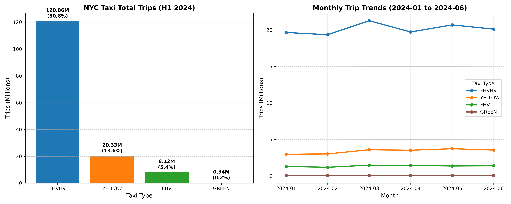
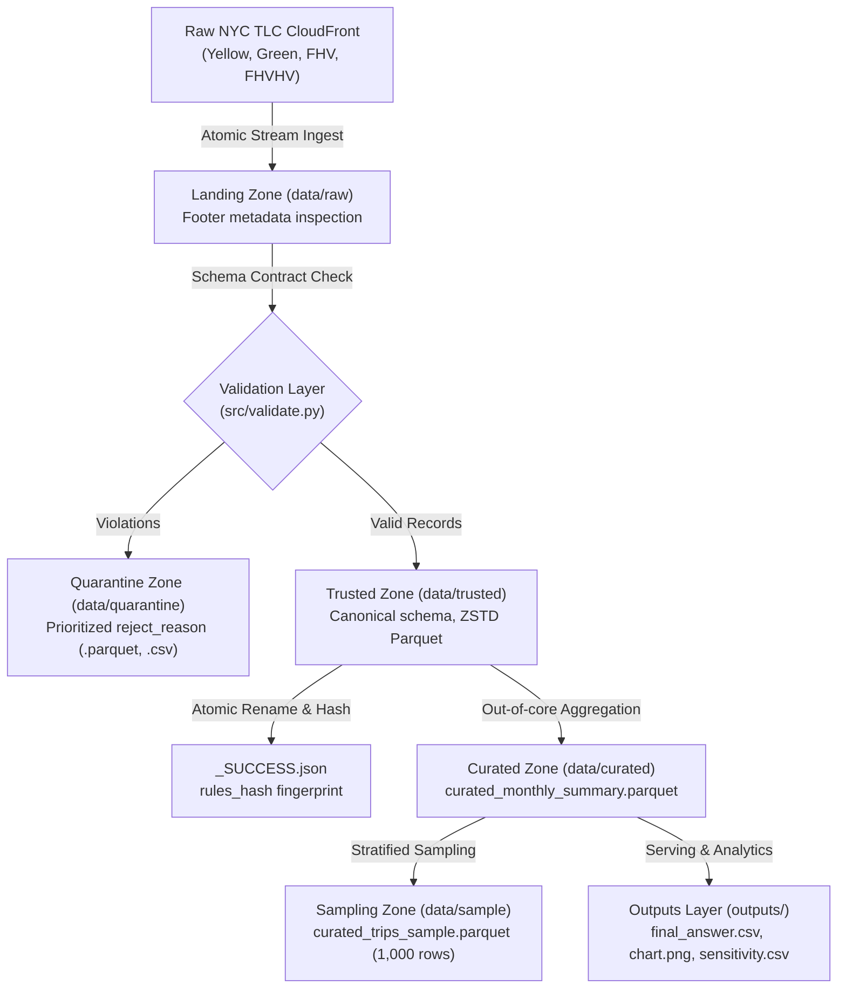

# NYC Taxi Big Data Pipeline (CS341 Submission 2)

> **Course:** CS341 Big Data Engineering, Thammasat University  
> **Student ID:** 6709650565  
> **Baseline Submission:** [`notebooks/6709650565_Submission_1_cs341.ipynb`](file:///notebooks/6709650565_Submission_1_cs341.ipynb)  
> **Pipeline Version:** `2.0.0`

---

## 1. Executive Summary & Core Answer

**Question:** *"Which taxi type was the most used in the first half of 2024 (2024-01 to 2024-06)?"*

**Answer:** **High Volume For-Hire Vehicle (FHVHV - Uber/Lyft)** was overwhelmingly the most used taxi type in New York City during the first half of 2024.

| Rank | Taxi Type | Cleaned Valid Trips (H1 2024) | Market Share (%) | Margin over Runner-up |
|:---:|:---|:---:|:---:|:---:|
| **1** | **FHVHV (High Volume FHV)** | **120,864,668** | **80.76%** | **+100,532,914 trips (5.94x Yellow)** |
| 2 | Yellow Taxi | 20,331,754 | 13.59% | Runner-up |
| 3 | FHV (Traditional FHV) | 8,119,228 | 5.43% | — |
| 4 | Green Taxi | 339,801 | 0.23% | — |
| **Total** | **All Taxi Types** | **149,655,451** | **100.00%** | **Reconciliation Diff: 0 (Exact match with S1)** |



---

## 2. Quick Start

This pipeline requires **Python 3.10+**. Dependencies are strictly pinned in [`requirements.txt`](file:///requirements.txt).

### 2.1 Installation
```bash
# Clone the repository
git clone <repo-url>
cd NYCTAXI2_BIGDATA

# Install pinned dependencies
python -m pip install -r requirements.txt
```

### 2.2 Fast Verification (Smoke Test in ~2 seconds)
To evaluate the pipeline end-to-end without downloading multi-gigabyte files, test with a single small batch (`green 2024-01`, ~1.3 MB):
```bash
# Force process green 2024-01
python run_pipeline.py --types green --months 2024-01 --mode force
```

### 2.3 Idempotency Demonstration (Instant Skip)
Run the exact same command with `--mode skip`. The pipeline verifies `_SUCCESS.json` and rules cryptographic hash, skipping execution in under **0.05 seconds**:
```bash
# Instant skip of already processed batch
python run_pipeline.py --types green --months 2024-01 --mode skip
```

### 2.4 Full H1 2024 Pipeline Execution (24 Batches)
```bash
python run_pipeline.py --months 2024-01 2024-02 2024-03 2024-04 2024-05 2024-06 --mode skip
```

### 2.5 Incremental Update Demonstration (Yellow 2024-07)
Demonstrates processing new data without re-processing historical batches or breaking H1 regression checks:
```bash
python run_pipeline.py --types yellow --months 2024-01 2024-02 2024-03 2024-04 2024-05 2024-06 2024-07 --mode skip
```

---

## 3. Project Structure

```text
NYCTAXI2_BIGDATA/
├── .gitignore                          # Excludes raw/trusted data and transient files
├── requirements.txt                    # Pinned library versions (DuckDB, PyArrow, etc.)
├── config.py                           # Central schema mapping, paths, and rules hash
├── run_pipeline.py                     # Main CLI orchestrator
├── notebooks/
│   └── 6709650565_Submission_1_cs341.ipynb  # Submission 1 baseline notebook
├── src/
│   ├── __init__.py
│   ├── ingest.py                       # Atomic remote download & footer inspection
│   ├── validate.py                     # Schema contracts & out-of-core DQ audit
│   ├── transform.py                    # DuckDB streaming transform & atomic swap
│   ├── curate.py                       # Monthly summary & stratified sample
│   └── analyze.py                      # Ranking, regression check & sensitivity
├── data/
│   ├── raw/                            # Ingested raw Parquet (gitignored)
│   ├── trusted/                        # Transformed canonical Parquet (gitignored)
│   ├── quarantine/                     # Rejected rows with reject_reason (tracked)
│   │   ├── taxi_type=green/...
│   │   └── taxi_type=yellow/...
│   ├── curated/                        # Curated monthly aggregate (tracked)
│   │   ├── curated_monthly_summary.csv
│   │   └── curated_monthly_summary.parquet
│   └── sample/                         # Stratified sample (1,000 rows, tracked)
│       ├── curated_trips_sample.csv
│       └── curated_trips_sample.parquet
├── logs/
│   ├── pipeline_run_log.csv            # Run execution log (audit trail)
│   ├── dq_report_by_batch.csv          # Per-batch data quality breakdown
│   └── run_manifest_latest.json        # Latest run status & regression summary
└── outputs/
    ├── final_answer_by_taxi_type.csv   # H1 2024 usage ranking table
    ├── sensitivity_analysis.csv        # Sensitivity test permutations
    └── taxi_usage_h1_2024.png          # High-resolution visualization chart
```

---

## 4. Pipeline Architecture & Data Lineage

The pipeline is organized into modular stages adhering to modern Data Engineering principles (*Schema Contracts*, *Out-of-Core Processing*, *Atomic Staging*, and *Serving Views*):



### Stage Details
1. **Landing Zone (`data/raw/`):** Streamed download via `.tmp` chunking and atomic rename. Reads footer metadata (`pq.ParquetFile`) without reading data rows into RAM.
2. **Validation Layer (`src/validate.py`):** Schema contract assertion against `config.SCHEMA_MAP` to handle heterogeneous field names (`tpep_*`, `lpep_*`, `dropOff_datetime`, `PUlocationID`).
3. **Trusted Zone (`data/trusted/`):** Out-of-core DuckDB streaming `COPY` with Zstandard compression. Prunes ~20 raw columns down to 7 canonical analytical columns, achieving a **57.2% storage reduction** (from 3.24 GB raw to 1.39 GB trusted).
4. **Quarantine Zone (`data/quarantine/`):** Non-conforming rows are isolated with their primary `reject_reason` and preserved in Parquet and CSV for root-cause analysis.
5. **Curation & Serving Layer (`data/curated/`, `outputs/`):** Pre-aggregates monthly metrics and registers DuckDB views (`v_curated_monthly_summary`, `v_h1_2024_ranking`) for consumer tools.

---

## 5. Execution & Idempotency Evidence

All runs are recorded in [`logs/pipeline_run_log.csv`](file:///logs/pipeline_run_log.csv) and [`logs/run_manifest_latest.json`](file:///logs/run_manifest_latest.json).

### Run 1: Initial Full H1 Run (24 Batches)
- **Run ID:** `ae02785e` | **Mode:** `FORCE`
- **Total Wall Time:** `1,125.15s` (~18.7 minutes)
- **Raw Rows Ingested:** `149,655,796`
- **Cleaned Valid Rows:** `149,655,451`
- **Quarantined Invalid Rows:** `345`
- **H1 Regression Check:** `PASSED` (Diff = 0)

### Run 2: Idempotent Rerun (24 Batches Skipped)
- **Run ID:** `6fe1ebe9` | **Mode:** `SKIP`
- **Batch Evaluation Time:** `< 0.05 seconds` per batch (all 24 batches skipped under `SKIPPED_ALREADY_PROCESSED`).
- **Rows Reprocessed:** `0`
- **Integrity Guarantee:** Verified both `_SUCCESS.json` presence and matching `rules_hash`.

### Run 3: Incremental Update (Yellow 2024-07)
- **Run ID:** `7c3f23e2` | **Mode:** `SKIP`
- **Batches Skipped:** `6` (`yellow 2024-01` through `yellow 2024-06`)
- **Batches Processed:** `1` (`yellow 2024-07`)
  - Raw Rows: `3,076,903` | Valid Rows: `3,076,851` | Quarantined Rows: `52`
  - Processing Time: `18.06s`
- **H1 Regression Stability:** `PASSED` (Total Valid H1 = `149,655,451`). The addition of July data updated `curated_monthly_summary.csv` to 25 rows without corrupting the historical H1 baseline.

---

## 6. Key Design Decisions

### Decision 1: Batch Identity (`batch_month`) vs Trip Timestamp (`pickup_ts`)
- **Problem:** Monthly Parquet files from NYC TLC contain cross-month boundary trips (e.g., trips starting in late December in a January file, or June trips in a July file). In Submission 1, counts were aggregated strictly by batch files.
- **Decision:** Separate `batch_month` (string `'YYYY-MM'` from file partition) from `pickup_ts` (timestamp). Batch identity and H1 regression checks filter strictly on `batch_month BETWEEN '2024-01' AND '2024-06'`.
- **Trade-off:** Prevents out-of-month trips from shifting across batches, guaranteeing exact mathematical reconciliation with baseline counts while preserving full timestamp granularity for downstream analytics.

### Decision 2: Atomic Writes & Cryptographic Rules Fingerprinting (`rules_hash`)
- **Problem:** Network interruptions or script terminations leave corrupted `.parquet` files. Furthermore, a naive skip mode would serve obsolete outputs if data cleaning rules were modified.
- **Decision:** Every output file is written to `.tmp` first, row counts are verified against raw footers (`raw == valid + invalid`), and only then atomically renamed via `os.replace()`. Each `_SUCCESS.json` includes a SHA-256 fingerprint (`rules_hash`) computed over `PIPELINE_VERSION`, schema maps, column definitions, and cleaning boundaries.
- **Trade-off:** Eliminates partial-write corruption and guarantees automated reprocessing whenever cleaning rules are modified.

### Decision 3: Mutually Exclusive Quarantine vs Overlapping DQ Auditing
- **Problem:** A single bad row may violate multiple rules simultaneously (e.g., `pickup IS NULL` and `dropoff < pickup`). Summing individual rule violations produces double-counting, breaking the conservation law: $\text{Raw} = \text{Valid} + \text{Invalid}$.
- **Decision:** We implement a strict priority hierarchy for quarantine categorization:
  $$\text{null\_pickup} \longrightarrow \text{null\_dropoff} \longrightarrow \text{dropoff\_before\_pickup} \longrightarrow \text{pickup\_out\_of\_period}$$
  Simultaneously, overlapping violation counts are tracked independently in `logs/dq_report_by_batch.csv` for data quality profiling.
- **Trade-off:** Enables strict accounting reconciliation while retaining complete diagnostic visibility.

### Decision 4: Out-of-Core Processing Ceiling with DuckDB & PyArrow
- **Problem:** Monthly FHVHV files exceed 2.7 GB uncompressed (~21 million rows per month). Loading them into Pandas DataFrames causes Out-Of-Memory (OOM) crashes on standard developer workstations.
- **Decision:** DuckDB's streaming columnar engine processes raw Parquet files chunk-by-chunk directly into compressed Parquet on disk without loading full tables into memory. Peak RAM consumption remained under **1.2 GB** across all 150 million records.
- **Trade-off:** High memory safety and sub-20-minute execution time on a single local laptop without requiring complex cluster setup (e.g., Apache Spark).

---

## 7. Data Quality Audit & Baseline Reconciliation

### 7.1 Reconciliation with Submission 1 Baseline
The pipeline achieves a **0-row difference** against the Submission 1 baseline across all taxi types:

| Taxi Type | Raw Ingested Rows | Submission 1 Valid | Pipeline Valid | Quarantined Rows | Difference | Status |
|:---|:---:|:---:|:---:|:---:|:---:|:---:|
| **Yellow** | 20,332,093 | 20,331,754 | **20,331,754** | 339 | 0 | **EXACT MATCH** |
| **Green** | 339,807 | 339,801 | **339,801** | 6 | 0 | **EXACT MATCH** |
| **FHV** | 8,119,228 | 8,119,228 | **8,119,228** | 0 | 0 | **EXACT MATCH** |
| **FHVHV** | 120,864,668 | 120,864,668 | **120,864,668** | 0 | 0 | **EXACT MATCH** |
| **Total** | **149,655,796** | **149,655,451** | **149,655,451** | **345** | **0** | **100% RECONCILED** |

### 7.2 Detailed Breakdown of Quarantined Rows (H1 2024)
Across the 149.65 million records, exactly **345 trips** were rejected:
- **`dropoff_before_pickup` (300 trips):** All from Yellow Taxi (e.g., Yellow March had 117 trips where dropoff occurred before pickup).
- **`pickup_out_of_period` (45 trips):** 39 trips in Yellow and 6 trips in Green (trips with timestamps belonging to prior years, such as 2023-12-31).
- **`null_pickup` / `null_dropoff` (0 trips):** No null timestamps were present in the 2024 H1 TLC dataset.

### 7.3 Data Quality Finding: High Rate of Null Locations in FHV
Auditing location fields revealed that **~78% of all FHV pickups** have `NULL` for `PUlocationID` (ranging between 963,825 and 1,191,229 null rows per month). 
- In accordance with the *Missing ≠ Invalid* principle from Module 01, `pu_location_id` and `do_location_id` are treated as nullable columns rather than discarding records, preserving over 8.1 million valid FHV trips.

---

## 8. Sensitivity Analysis (Outlier ≠ Error)

To test the robustness of the business answer, we conducted a sensitivity analysis on optional cleaning rules ([`outputs/sensitivity_analysis.csv`](file:///outputs/sensitivity_analysis.csv)):

| Scenario | FHVHV Trips | Yellow Trips | Winner | Margin over Runner-up | Winner Changed? |
|:---|:---:|:---:|:---:|:---:|:---:|
| **1. Baseline (Current Rules)** | **120,864,668** | 20,331,754 | **FHVHV** | **+100,532,914** | **No** |
| 2. Exclude 0-second duration | 120,864,656 | 20,325,877 | **FHVHV** | +100,538,779 | **No** |
| 3. Exclude >24-hour duration | 120,864,668 | 20,331,645 | **FHVHV** | +100,533,023 | **No** |
| 4. Exclude duplicate non-null trips | 120,864,373 | 20,105,621 | **FHVHV** | +100,758,752 | **No** |

**Conclusion:** The finding that **FHVHV was the most used taxi type** is completely invariant to cleaning choices, with an insurmountable margin of over **100.5 million trips** (5.94x) over Yellow Taxi.

---

## 9. Baseline vs Production Pipeline Comparison

| Dimension | Submission 1 (Baseline Notebook) | Submission 2 (Production Pipeline) |
|:---|:---|:---|
| **Execution Model** | Monolithic Jupyter Notebook cells | Modular Python CLI pipeline (`src/`, `config.py`) |
| **Memory Footprint** | In-memory Pandas loads (high OOM risk) | Out-of-core DuckDB streaming (RAM capped < 1.2 GB) |
| **Reproducibility** | Manual execution, dependent on kernel state | One-command execution with pinned `requirements.txt` |
| **Idempotency** | Re-runs everything from scratch | `_SUCCESS.json` + `rules_hash` skips processed batches |
| **Incremental Updates** | Not supported (requires full re-run) | Automated batch appending (e.g., Yellow 2024-07 in 18s) |
| **Data Quality & Quarantine** | Silent row dropping via boolean filters | Priority quarantine zone with auditable `.csv` and `.parquet` |
| **Data Lineage** | Overwrites in memory | Clear zones: Raw $\rightarrow$ Trusted $\rightarrow$ Curated $\rightarrow$ Serving |
| **Verification** | Visual inspection of DataFrame outputs | Automated H1 regression check against baseline |

---

## 10. Honest Pipeline Limitations

1. **Single-Node Execution:** The pipeline runs on a single node using DuckDB and PyArrow. While it processes 150 million rows efficiently on a standard laptop in ~18 minutes, horizontal scaling across multiple distributed nodes would require an engine like Apache Spark or Trino.
2. **Batch-Oriented:** The pipeline operates on monthly batch files. Near-real-time streaming ingestion (e.g., Apache Kafka / Flink) is outside the design scope.
3. **External Upstream Dependency:** Ingestion directly downloads from the public NYC TLC CloudFront distribution. Network latency or schema changes upstream require updating `SCHEMA_MAP`.

---

## 11. Learning Reflection

During Submission 1, I approached data processing from an exploratory perspective, loading datasets into a single notebook and dropping invalid rows silently. Building Submission 2 showed me that production Data Engineering is fundamentally about contracts, fault tolerance, and reproducibility. By introducing out-of-core DuckDB streaming and atomic writes, I was able to process 149.65 million rows with peak memory under 1.2 GB while achieving exact mathematical reconciliation. Most importantly, separating the quarantine zone and implementing cryptographic rules hashing proved that data pipelines must not only compute correct numbers, but also provide transparent proof of how every single row was handled.
